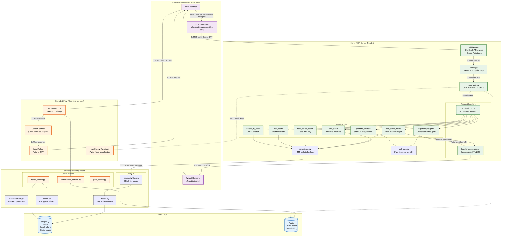

# Clarity Architecture

## What is MCP?

**Model Context Protocol (MCP)** is a standard by Anthropic for connecting AI assistants to external tools and data. Think of it as a REST API specifically designed for LLMs:

- ChatGPT calls **tools** (like API endpoints) on the MCP server
- The server returns **structured data** that ChatGPT can use
- Tools can also return **widgets** (React components) that render in the ChatGPT UI

**Key difference from REST**: MCP responses include `structuredContent` with both data AND instructions for the AI on how to respond to the user (`assistant_guidance`).

---

## High-Level Flow

```
┌─────────────────────────────────────────────────────────────────────────┐
│                              ChatGPT                                     │
│  ┌──────────────┐    ┌──────────────┐    ┌──────────────────────────┐   │
│  │   User Chat  │───▶│  AI Reasoning │───▶│  Widget Renderer (React) │   │
│  └──────────────┘    └──────────────┘    └──────────────────────────┘   │
└─────────────────────────────────────────────────────────────────────────┘
          │                    │                         ▲
          │                    │ MCP Tool Call           │ Widget HTML/JS
          │                    ▼                         │
┌─────────────────────────────────────────────────────────────────────────┐
│                         Clarity MCP Server                               │
│                    (Python / FastMCP / Starlette)                        │
└─────────────────────────────────────────────────────────────────────────┘
          │                                              │
          │ HTTP (sync)                                  │ HTTP (sync)
          ▼                                              ▼
┌─────────────────────────┐                 ┌─────────────────────────┐
│   Shared Backend        │                 │   OAuth 2.1 Provider    │
│   (FastAPI)             │                 │   (JWT/RS256)           │
└─────────────────────────┘                 └─────────────────────────┘
          │                                              │
          ▼                                              ▼
┌─────────────────────────────────────────────────────────────────────────┐
│                         PostgreSQL + Redis                               │
└─────────────────────────────────────────────────────────────────────────┘
```

---

## Detailed Architecture



---

## Key Concepts for Reviewers

### 1. Stateless Design
- No server-side sessions
- Every request includes JWT in `Authorization: Bearer` header
- Enables horizontal scaling (just add more instances)

### 2. Separation of Concerns

| Layer | Responsibility |
|-------|----------------|
| **ChatGPT LLM** | Reasoning, clustering thoughts, deciding which tool to call |
| **MCP Server** | Validation, formatting, scope enforcement |
| **Backend API** | Database CRUD, encryption |
| **Widget** | Visual rendering of clusters |


### 3. Security Model

```
User ──OAuth──▶ JWT (RS256, 1h expiry)
                    │
                    ▼
            MCP Server validates:
            1. Signature (via JWKS)
            2. Expiry
            3. Scopes (clarity.read, clarity.write)
                    │
                    ▼
            Tool executes if authorized
```

### 4. Widget Integration

Tools can return a `widget_uri` pointing to a React component:
```
organize_thoughts returns:
├── content: "" (empty, LLM uses assistant_guidance instead)
├── structuredContent:
│   ├── clusters: [...data for widget...]
│   ├── thoughts_exhausted: bool
│   └── assistant_guidance: "Say this to user..."
└── _meta:
    └── openai/outputTemplate: "resource://clarity-widget"
```

ChatGPT fetches the widget via `ResourceHandler` and renders it in an iframe.

---

## Data Flow Example

**User says**: "I'm overwhelmed, help me organize my thoughts"

1. **ChatGPT LLM** recognizes intent, collects thoughts through conversation
2. **LLM clusters** the thoughts (AI reasoning happens here, not in backend)
3. **LLM calls** `organize_thoughts` tool with clustered data
4. **MCP Server** validates JWT, checks `clarity.write` scope
5. **Tool** validates input schema, enriches clusters (adds counts)
6. **Response** includes widget URI + `assistant_guidance`
7. **ChatGPT** renders widget, follows guidance to ask about priorities
8. **User** selects P1/P2/P3, LLM calls `prioritize_clusters`
9. **User** says "save this", LLM calls `save_board`
10. **Backend** persists to PostgreSQL

---

## Deployment

| Component | Platform | URL Pattern |
|-----------|----------|-------------|
| MCP Server | Render | `https://clarity-mcp.onrender.com/mcp` |
| Backend API | Render | `https://priority-guardian.onrender.com/api/...` |
| PostgreSQL | Render | Managed database |
| Redis | Render | Managed Redis |
